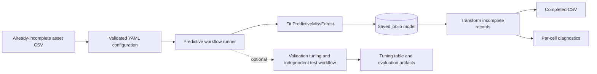
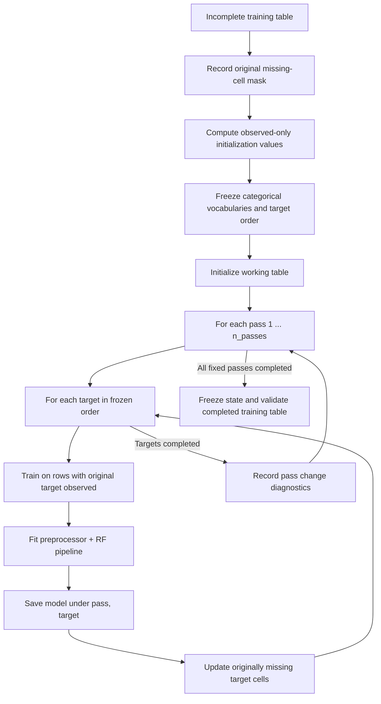

# Predictive MissForest — Implementation and Usage Guide

> **Team 19 | SA Power Networks Capstone Project**  
> **Component:** Overhead-conductor missing-value imputation  
> **Documentation scope:** Implementation, configuration, execution, verification, and maintenance  
> **Related work:** Experimental design, comparisons, metrics, noise robustness, and research findings belong in the **separate evaluation ticket**.

## Contents

1. [Overview](#1-overview)
2. [What is implemented](#2-what-is-implemented)
3. [Repository components](#3-repository-components)
4. [Input contract and model attributes](#4-input-contract-and-model-attributes)
5. [Algorithm design](#5-algorithm-design)
6. [Implementation details and safeguards](#6-implementation-details-and-safeguards)
7. [Configuration](#7-configuration)
8. [Running the workflow](#8-running-the-workflow)
9. [Output artifacts](#9-output-artifacts)
10. [Python API](#10-python-api)
11. [Validation and troubleshooting](#11-validation-and-troubleshooting)
12. [Reproducibility, limitations, and repository hygiene](#12-reproducibility-limitations-and-repository-hygiene)

---

## 1. Overview

**Predictive MissForest** extends the project's existing whole-table MissForest implementation by providing a reusable **`fit()` / `transform()`** interface for mixed numerical and categorical asset records.

The conventional project implementation (`missforest.py`) runs the iterative imputation procedure against a supplied incomplete table. The predictive implementation instead **persists the trained models for every target and iteration pass**, allowing the learned sequence to be replayed on later incomplete records **without fitting new forests**.

The implementation accepts an **already-incomplete CSV**: the workflow runner does not generate the main missingness scenario. Natural missingness and synthetic scenario masking must be prepared upstream.

### Component architecture



**Core implementation responsibilities:**

- Impute numerical and categorical attributes in one iterative workflow.
- Learn from incomplete training rows without requiring completely observed records.
- Reuse fitted forests when imputing subsequent records.
- Preserve originally observed values, column ordering, non-model fields, and row count.
- Support persistence, configuration validation, traceable partitions, and optional diagnostics.

**Not in this document:** benchmark results, model rankings, confusion matrices, statistical conclusions, or noise robustness curves. Those belong in the evaluation ticket.

## 2. What is implemented

| Capability | Implementation |
|---|---|
| Mixed-type targets | `RandomForestRegressor` for numerical targets; `RandomForestClassifier` for categorical targets |
| Preprocessing | Numerical pass-through and fitted `OneHotEncoder` within each scikit-learn `Pipeline` |
| Initial fill | Training-observed numerical mean/median; deterministic categorical mode |
| Iterative updates | Configurable fixed `n_passes` (prototype: 5) |
| Stored models | One fitted pipeline per `(pass_number, target)` where sufficient target observations exist |
| Inference | Frozen sequential replay; `transform()` never calls `fit()` |
| Input integrity | Observed values and non-model columns preserved; constraints applied to newly imputed cells |
| Persistence | Compressed `.joblib` save/load with format and dependency-version metadata |
| Workflow modes | `fit_only`, `fit_transform`, `transform_only`, `evaluate_only` |
| Optional tuning | Validation-only grid search, `year_material` or `all_attributes` objective |
| Optional evaluation | Extra masking of already-observed held-out cells; separate evaluation model |
| Traceability | Stable `segment_id` partition manifest and fitting-ID provenance sidecar |
| Diagnostics | Pass-level numerical/categorical changes; optional final-pass per-cell scores |

> **Important:** Fixed passes are intentional. `convergence_training.csv` records change between passes; it does **not** trigger convergence-based early stopping in this implementation.

## 3. Repository components

These are the source/configuration paths used by the workflow. Names below describe the files in the implementation; generated models and outputs should not be committed.

```text
team19-asset-data/
├── src/team19_asset_data/imputation/
│   ├── predictive_missforest.py          # Fit, frozen transform, save/load, diagnostics
│   ├── predictive_tuning.py              # Validation masks, grid search, objectives
│   ├── evaluation.py                     # Additional test masks and scoring helpers
│   ├── config.py                         # YAML loading and configuration validation
│   ├── postprocess.py                    # Constraints on imputed values
│   ├── simple_imputer.py                 # Deterministic mode helper
│   └── missforest.py                     # Existing whole-table method (unchanged)
├── experiments/
│   └── run_predictive_imputation_experiment.py
│                                       # CLI workflow and generated artifacts
├── config/imputation/
│   ├── overhead_conductors_prototype_v2.yaml
│   ├── overhead_conductors_tuning_v2.yaml
│   └── overhead_conductors_all_attributes_v2.yaml
└── docs/predictive_missforest/
    └── README.md                         # This document (suggested location)
```

| Module | Main entry points | Responsibility |
|---|---|---|
| `predictive_missforest.py` | `PredictiveMissForest`, `PredictiveMissForestConfig` | Model training and reuse |
| `predictive_tuning.py` | `tune_predictive_missforest`, `TuningObjective`, `prepare_tuning_holdout` | Hyperparameter selection, validation-only |
| `evaluation.py` | `prepare_evaluation_holdout`, `evaluate_imputation` | Controlled scoring on known masked cells |
| `config.py` | `load_imputation_config` | Asset schema and workflow options |
| `run_predictive_imputation_experiment.py` | `main()` | End-to-end CLI; partitions, artifacts, provenance |

## 4. Input contract and model attributes

The prototype processes **seven model attributes**:

| Attribute | Data type |
|---|---|
| `installation_year` | Numerical |
| `distance_to_sea_km` | Numerical |
| `voltage_category` | Categorical |
| `location_group` | Categorical |
| `corrosion_zone` | Categorical |
| `material` | Categorical |
| `covering` | Categorical |

`segment_id` is required by the **CLI runner** for row-identity checks, partitioning, reference alignment, and provenance. `feeder_id` can be used for group-aware partitioning. The underlying imputer uses the seven configured model columns and retains additional fields in the returned DataFrame without using them as predictors.

The current prototype intentionally excludes `asset_age` (derived from installation year), `conductor_type` (potential direct material leakage), and `length_km` (generator-specific shortcut concerns). These exclusions are prototype design decisions, not a permanent claim about all SAPN datasets.

**Required input characteristics:**

- A nonempty table containing all configured model attributes, with numerical observed values convertible to numbers.
- At least one originally observed fitting value per target, so a training initialization statistic can be calculated.
- Categorical observations within a target must use a consistent Python value type; strings are recommended.
- The CLI runner additionally requires unique, nonmissing, nonblank `segment_id` values.
- No `dropna()` of incomplete rows is required. A row may have missing predictors and still be used to train forests for targets that are observed in that row.

**Low-support targets:** If a target has fewer than `min_observed_target` observed training values, it is marked as *unmodelled* and receives its initial fill value instead of a fitted target forest. A completely unobserved target at fit time is rejected because initialization is impossible.

## 5. Algorithm design

### 5.1 Fitting on incomplete training data

`fit(X_fit)` first computes training-only initialization statistics, records categorical vocabularies, and freezes the target processing order. Targets are sorted by **ascending training missingness**, with configuration order breaking ties.

For each of the fixed passes, each target is predicted from the **other six model attributes**. Training rows are those with an **originally observed value for the current target**; values of other predictor columns may already have been initialized or imputed in the working table. Once that target's forest is fitted, it updates the target's originally missing cells before the next target is processed.



A single target-model pipeline follows this structure:


**Classifier/regressor selection:** Numerical targets use `RandomForestRegressor`, while categorical targets use `RandomForestClassifier`. `class_weight` applies only to classifiers. The preprocessing encoder uses **fit-time categorical vocabularies**, so model feature dimensions remain consistent across passes and subsequent transforms.

The stored-model count is:

```text
fitted pipelines = n_passes × number of targets with sufficient observed data
```

For the prototype configuration with five passes and all seven targets modelled, that is **35 fitted pipelines**. Each pipeline contains a forest with `n_estimators` trees. This is an architectural count, not an accuracy result.

### 5.2 Transforming new incomplete records

`transform(X_new)` does not train any models. It applies the stored initial-fill statistics and **replays every stored pipeline in the same pass/target order**, updating only cells missing in the incoming input.

```mermaid
sequenceDiagram
    participant User as Caller
    participant PMF as PredictiveMissForest
    participant S as Saved fit state
    User->>PMF: transform(X_new)
    PMF->>S: Read initialization stats, vocabularies, target order
    PMF->>PMF: Save incoming missing mask; initialize working copy
    loop Each fixed pass
        loop Each modelled target
            PMF->>S: Fetch pipeline(pass, target)
            S-->>PMF: Fitted preprocessor + forest
            PMF->>PMF: Predict only missing target cells
        end
    end
    PMF->>PMF: Restore observed values; apply constraints to imputed cells
    PMF-->>User: Completed DataFrame
```

`transform()` supports new batches, including records with all seven model values missing (using learned initial states/pipelines), provided the expected columns exist. It should **not** be interpreted as learning from newly observed values: retraining requires a separate `fit()` call.

### 5.3 Fixed passes versus standard MissForest

The project's existing `missforest.py` provides a whole-table iterative algorithm with a convergence-based stopping procedure. Predictive MissForest instead saves **every pass-specific estimator** so that later inference can reconstruct the sequential imputation state. The fixed pass count makes the replay sequence well-defined. The existing MissForest module is retained separately rather than replaced.

## 6. Implementation details and safeguards

### 6.1 Original data preservation

- Missingness masks are captured **before initialization** and are used for updates throughout each pass.
- Supervised target labels come only from the **originally observed** target cells; filled placeholders do not become target labels.
- Output is built from a copy of the caller's input and only originally missing model cells are replaced.
- Configured numeric/category constraints are applied to newly imputed cells by `postprocess.py`.
- Result validation checks row count, index, column order, missing target cells, unchanged observed values, and unchanged non-model columns.

### 6.2 Unseen categorical values

`unknown_category_policy` governs observed categories in incoming records that were not seen at fit time:

| Value | Prediction-time behavior |
|---|---|
| `ignore` | Unknown category remains in the returned observed input; one-hot encoding treats it as unrecognised |
| `mode` | Use the training mode **internally as a predictor**, while retaining the caller's originally observed value in the output |
| `error` | Reject the input with a descriptive error |

### 6.3 Per-cell diagnostic output

`transform_detailed(X, with_scores=True)` returns a `TransformResult` containing the completed table, incoming missing mask, counts of unseen categories, elapsed time, and per-cell scores. `predict_scores(X)` retrieves the score table directly.

| Target type | Diagnostic fields | Interpretation |
|---|---|---|
| Categorical | `max_proba`, `margin`, `entropy` | Forest class-vote concentration and ambiguity |
| Numerical | `tree_std`, `tree_p10`, `tree_p90` | Dispersion of individual tree predictions |

These diagnostics are **uncalibrated model indicators**, not guarantees of correctness or calibrated prediction intervals. The diagnostic `imputed` field reflects the forest's raw final-pass prediction, which can differ from final constrained output.

### 6.4 Model persistence

A fitted model is serialized with `joblib` using compression. The payload records a format version and the installed scikit-learn/pandas/NumPy versions. Loading a model fitted with a different scikit-learn version produces a warning; it should be replay-tested before use.

**Security:** Only load `.joblib` files from trusted sources. Deserialization can execute arbitrary code.

## 7. Configuration

The YAML configuration retains existing `version`, `asset_class`, `columns`, `constraints`, and `methods` sections. The following excerpt shows the relevant predictive/workflow settings; it is **not a complete standalone YAML** because the model attribute definitions and constraints also remain required.

```yaml
methods:
  predictive_missforest:
    n_estimators: 100
    n_passes: 5
    random_state: 219
    n_jobs: 1
    max_features: "sqrt"
    max_depth: null
    min_samples_leaf: 1
    class_weight: null
    numeric_init: "mean"
    unknown_category_policy: "ignore"
    min_observed_target: 2

execution:
  mode: fit_transform
  model_path: outputs/models/predictive_missforest.joblib

tuning:
  enabled: false
  objective: year_material  # year_material | all_attributes
  mask_rate: 0.10
  mask_seed: 219
  grid:
    max_depth: [4, 8, 16, null]
    min_samples_leaf: [1, 2, 10]

evaluation:
  enabled: false
  mask_rate: 0.10
  mask_seed: 319

data_split:
  train: 0.60
  validation: 0.10
  calibration: 0.10
  test: 0.20
  random_seed: 219
  strategy: row              # row | group
  group_column: null        # required if strategy: group
```

### Execution modes

| Mode | Behavior | Precondition |
|---|---|---|
| `fit_only` | Fit and save the final model; optional tuning/evaluation may also run if enabled | Input CSV and writable model path |
| `fit_transform` | Fit on the input, save the model, and complete the input | Input CSV and writable output path |
| `transform_only` | Load a saved model and impute the input without retraining | Existing fitted model; normally disable tuning and evaluation |
| `evaluate_only` | Load a saved model, create/reuse a secondary holdout mask, and score it | Evaluation enabled, tuning disabled, independent records not used to fit model |

**CLI overrides:** `--mode` overrides `execution.mode`; `--model-path` overrides `execution.model_path`. A relative model path is resolved from the **repository root**, not from `--output-dir`.

### Optional tuning implementation

When enabled, the runner uses its **training partition** for fitting candidate forests and masks known values in its **validation partition** for candidate selection. The same temporary validation mask is reused for every candidate. There are two supported objectives:

- `year_material` (default): combines `installation_year` MAE normalized by training-year IQR with `1 − material Macro-F1`, with equal default weights.
- `all_attributes`: averages training-IQR-normalized MAE across all numerical attributes and `1 − Macro-F1` across all categorical attributes, then combines the numerical and categorical group losses with equal default weights.

The grid is applied to `max_depth` and `min_samples_leaf`; the selected configuration is subsequently used to fit the final model. Class imbalance and very small validation class counts can make category-level tuning scores unstable; the all-attribute implementation warns when a categorical holdout contains fewer than two classes.

### Partition design

With tuning/evaluation disabled, normal `fit_transform` **does not need to split** the input. With either enabled, the runner creates or reuses `partition_manifest.csv` keyed by `segment_id`. Splitting supports deterministic row-based assignment or group-aware assignment using, for example, `feeder_id`; group sizes can prevent exact proportional counts. The calibration partition is reserved and not used by this runner.

An evaluation model is fitted on **training records only**. Separately, the final operational model is fitted on **all eligible input records**. A final model fitted on every input record must **not** be presented as an independently evaluated model on those same records.

## 8. Running the workflow

All commands below are run from the repository root and use the module runner. They are **usage examples**, not recorded experiment results.

### 8.1 Prerequisites

Use the repository's existing Python environment with `pandas`, `numpy`, `scikit-learn`, `joblib`, and `PyYAML` installed. Confirm the environment can import the package:

```bash
PYTHONPATH=src python -c "from team19_asset_data.imputation.predictive_missforest import PredictiveMissForest; print('Import OK')"
```

### 8.2 Fit and impute an already-masked CSV

With `execution.mode: fit_transform`, `tuning.enabled: false`, and `evaluation.enabled: false`:

```bash
PYTHONPATH=src python -m experiments.run_predictive_imputation_experiment \
  --input-csv data/synthetic/overhead_conductors/strength_100/masked/MF01/masked_MF01.csv \
  --config config/imputation/overhead_conductors_prototype_v2.yaml \
  --output-dir outputs/predictive_missforest
```

This saves the final model at `execution.model_path` and, in `--output-dir`, the imputed CSV, pass-change log, and diagnostics.

### 8.3 Fit a model without writing a completed CSV

Set `execution.mode: fit_only` (or use `--mode fit_only`). The fitted artifact is still written to the model path:

```bash
PYTHONPATH=src python -m experiments.run_predictive_imputation_experiment \
  --mode fit_only \
  --input-csv data/synthetic/overhead_conductors/strength_100/masked/MF01/masked_MF01.csv \
  --config config/imputation/overhead_conductors_prototype_v2.yaml \
  --output-dir outputs/predictive_fit_only \
  --model-path outputs/models/predictive_fit_only.joblib
```

### 8.4 Apply a saved model to new records

Turn tuning and evaluation off in the configuration used for prediction; use an input containing records with the same model columns:

```bash
PYTHONPATH=src python -m experiments.run_predictive_imputation_experiment \
  --mode transform_only \
  --input-csv data/incoming/overhead_conductors_incomplete.csv \
  --config config/imputation/overhead_conductors_prototype_v2.yaml \
  --output-dir outputs/predictive_incoming \
  --model-path outputs/models/predictive_fit_only.joblib
```

`data/incoming/overhead_conductors_incomplete.csv` is a **placeholder for your own incoming CSV**; it is not a repository file created by this component.

### 8.5 Run optional validation tuning and evaluation

Use a separate YAML copy, e.g. `config/imputation/overhead_conductors_all_attributes_v2.yaml`, with:

```yaml
tuning:
  enabled: true
  objective: all_attributes
  mask_rate: 0.10
  mask_seed: 219
  grid:
    max_depth: [4, 8, 16, null]
    min_samples_leaf: [1, 2, 10]

evaluation:
  enabled: true
  mask_rate: 0.10
  mask_seed: 319
```

Then execute:

```bash
PYTHONPATH=src python -m experiments.run_predictive_imputation_experiment \
  --input-csv data/synthetic/overhead_conductors/strength_100/masked/MF01/masked_MF01.csv \
  --config config/imputation/overhead_conductors_all_attributes_v2.yaml \
  --output-dir outputs/predictive_missforest_all_attributes
```

For reproducibility, give each workflow run a **distinct `--output-dir` and `execution.model_path`**. Reusing either location can overwrite its previous artifacts.

### 8.6 Other CLI options

| Flag | Purpose |
|---|---|
| `--partition-manifest PATH` | Create or reuse an ID-keyed partition assignment |
| `--evaluation-mask-csv PATH` | Reuse an additional evaluation mask (not the original scenario mask) |
| `--truth-csv PATH` | Supply aligned clean synthetic truth for scoring extra evaluation-masked cells |
| `--id-column NAME` | Change the record-ID column (default `segment_id`) |
| `--sample-rows N` | Development-only small run; not for final evaluation |
| `--n-estimators N` | Development-only override of forest size |
| `--n-passes N` | Development-only override of fixed pass count |

**Important masking distinction:** The workflow does not create the dataset's original missingness. During optional tuning/evaluation it temporarily hides **additional currently observed values** to make their truth measurable. Original naturally missing cells have unknown truth and are **not** scored by that workflow unless an external evaluation procedure explicitly supplies valid truth and the corresponding original mask.

## 9. Output artifacts

Artifacts are conditional on the execution mode and on the tuning/evaluation flags.

| File | When generated | Description |
|---|---|---|
| `outputs/models/*.joblib` or configured path | Fit modes | Final fitted imputer: statistics, frozen vocabularies, pipelines and configuration |
| `<model>.joblib.provenance.json` | Fit modes | Hashes of fitted record IDs used for independent-evaluation overlap checks |
| `predictive_imputed_full.csv` | `fit_transform`, `transform_only` | Completed input records |
| `predictive_diagnostics_full.csv` | `fit_transform`, `transform_only` | Final-pass diagnostics for imputed cells |
| `convergence_training.csv` | Fit modes | Numerical/categorical change per pass (diagnostic, not an early-stop trigger) |
| `run_metadata.json` | All modes | Execution settings and available run/provenance fields |
| `partition_manifest.csv` | Tuning/test partition workflow | Record-to-partition assignment |
| `tuning_validation.csv` | Tuning enabled | Grid candidates, objective, per-attribute tuning diagnostics |
| `evaluation_model.joblib` | Evaluation enabled in fit mode | Separately fitted training-partition-only model |
| `evaluation_model.joblib.provenance.json` | Evaluation enabled in fit mode | Training-record ID fingerprints |
| `masked_test.csv` | Evaluation | Input with extra known cells hidden |
| `test_hidden_mask.csv` | Evaluation | Which values were additionally hidden for scoring |
| `predictive_imputed_test.csv` | Evaluation | Completed extra-masked test records |
| `predictive_diagnostics_test.csv` | Evaluation | Per-cell evaluation diagnostics |
| `baseline_imputed_test.csv` | Evaluation during fit modes | Training-fitted Median/Mode baseline predictions |
| `metrics_test.csv` | Evaluation | Attribute-wise evaluation metrics for extra-masked known cells |

The fitting-model and full-output paths are different: `--output-dir` controls output CSV/diagnostics, while `execution.model_path` controls the saved **final** model path. If evaluation is enabled, the **separate** training-only evaluation model is stored under `--output-dir`.

## 10. Python API

The estimator can also be used without the CLI:

```python
import pandas as pd

from team19_asset_data.imputation.config import load_imputation_config
from team19_asset_data.imputation.predictive_missforest import PredictiveMissForest

cfg = load_imputation_config(
    "config/imputation/overhead_conductors_prototype_v2.yaml"
)

training = pd.read_csv("path/to/incomplete_training.csv")
model = PredictiveMissForest.from_imputation_config(cfg)
model.fit(training)

# No retraining is performed here.
incoming = pd.read_csv("path/to/incomplete_incoming.csv")
completed = model.transform(incoming)

# Diagnostics are optional.
detail = model.transform_detailed(incoming, with_scores=True)
print(detail.unknown_category_counts)
print(detail.scores.head())

model.save("path/to/trusted_predictive_missforest.joblib")
reloaded = PredictiveMissForest.load("path/to/trusted_predictive_missforest.joblib")
completed_again = reloaded.transform(incoming)
```

**Note:** When calling `.save()` directly, ensure the destination parent directory already exists. The CLI runner creates the parent directory for its configured model path.

Useful fitted properties include `fit_report_`, `convergence_`, `fit_imputed_`, `target_order_`, `unmodelled_targets_`, and `models_`. Inspect a particular fitted pipeline with `model.get_pipeline(pass_number, target)`.

## 11. Validation and troubleshooting

### 11.1 Basic command checks

```bash
# Verify CLI options and discover the supported execution overrides.
PYTHONPATH=src python -m experiments.run_predictive_imputation_experiment --help

# Run repository tests from the project root (if pytest is configured).
PYTHONPATH=src python -m pytest -q
```

### 11.2 Verify output integrity

The following script checks core invariants for a completed batch (adjust paths if needed):

```bash
python - <<'PY'
import pandas as pd

original = pd.read_csv(
    "data/synthetic/overhead_conductors/strength_100/masked/MF01/masked_MF01.csv"
)
completed = pd.read_csv(
    "outputs/predictive_missforest/predictive_imputed_full.csv"
)

columns = [
    "installation_year", "distance_to_sea_km", "voltage_category",
    "location_group", "corrosion_zone", "material", "covering",
]

assert original.shape == completed.shape
assert original.columns.tolist() == completed.columns.tolist()
assert original["segment_id"].equals(completed["segment_id"])

for column in columns:
    observed = original[column].notna()
    assert original.loc[observed, column].equals(completed.loc[observed, column]), column
    assert not completed[column].isna().any(), column

print("PASS: same rows/columns; observed values preserved; model targets complete")
PY
```

This confirms **data integrity**, not the accuracy of inferred values. The estimator independently validates these invariants during `fit()` and `transform()`.

### 11.3 Common issues

| Symptom | Likely cause / remedy |
|---|---|
| `Missing model columns` | Check the CSV headers against the YAML model-column declarations. |
| `segment_id` is absent/duplicated | Supply unique, stable IDs before using the CLI runner. |
| All values missing in a target during `fit()` | At least one observed target value is required for initialization; otherwise fit cannot proceed. |
| Unknown categorical values at transform | Choose `ignore`, `mode` or `error` deliberately in `unknown_category_policy`. |
| `tuning.enabled must be false` | Disable tuning before using `transform_only` or `evaluate_only`. |
| Independent-evaluation overlap error | The input record IDs were present during model fitting; use a genuinely independent batch or the saved training-only evaluation model. |
| `No saved fitting-ID provenance` | Independent evaluation requires a model saved by this runner with its sidecar file. |
| Evaluation mask includes pre-existing nulls | Hold out only originally observed cells; the additional holdout mask is not the scenario's primary mask. |
| Zero/invalid training IQR for an all-attribute target | That objective cannot normalize the target without revisiting the scale/target set. |
| Earlier files disappear or change | Use a new `--output-dir` **and** a distinct final `model_path` for each run. |
| Model file is unexpectedly large | Every pass/target forest is persisted; avoid committing generated `.joblib` binaries to Git. |

## 12. Reproducibility, limitations, and repository hygiene

### Reproducibility checklist

- [ ] Freeze the repository revision and YAML configuration used for each run.
- [ ] Record the input CSV reference, partition manifest, and any secondary evaluation mask.
- [ ] Use fixed `random_state`, `mask_seed`, and `data_split.random_seed` for reproducible development runs.
- [ ] Preserve Python/package version information; model loading across scikit-learn versions may change behavior.
- [ ] Keep final-fit models separate from held-out evaluation models.
- [ ] Verify that no original observed target values or non-model fields changed.
- [ ] Avoid scoring the original naturally missing values unless independently known truth exists.

### Design limitations and scope boundaries

- Saved forests provide **reusable inference**, not incremental learning; new training information requires a new fit.
- Fixed passes do not implement adaptive convergence-based stopping.
- A target with too little training support falls back to an initialization value; it is listed in `unmodelled_targets_`.
- The current configuration uses shared forest hyperparameters across targets; it does not tune a separate configuration per attribute.
- Uncalibrated diagnostic scores are not statistically validated confidence intervals.
- A valid imputed value is not necessarily a correct one; quality depends on the data's underlying relationships and missingness mechanism.
- Training on naturally incomplete data is supported, but missing values with no known ground truth cannot be objectively scored without a separate reference or controlled holdout.
- The implementation should be validated against real data definitions and operational constraints before it is used in production workflows.

### What to commit for the implementation ticket

**Commit:** source modules, workflow runner, YAML configurations, focused tests, and this README. Keep implementation documentation **separate** from the later experimental-evaluation report.

**Do not commit by default:** generated imputed CSVs, `outputs/` directories, large synthetic datasets, saved joblib models, and plots/metrics from experimental runs. Models should be regenerated or stored under an explicitly approved artifact process. A `.joblib` file can exceed typical GitHub per-file limits.

### Suggested implementation-ticket completion checklist

- [ ] Core estimator integrated beside, not over, existing `missforest.py`.
- [ ] Training-only initialization and fixed-pass forest persistence implemented.
- [ ] `fit()`, `transform()`, `save()`, and `load()` exercised.
- [ ] Optional tuning and secondary evaluation integrated into the CLI runner.
- [ ] Execution modes, model path handling, and ID-based partitioning documented.
- [ ] Imputation integrity and provenance safeguards checked.
- [ ] Implementation README included in the pull request.
- [ ] Experimental results and noise robustness explicitly tracked in the **separate evaluation ticket**.

---

**Maintenance note:** If the estimator API, YAML keys, or runner output filenames change, update this README in the same pull request. Maintain quantitative performance findings in the independent experiment/evaluation documentation rather than expanding this implementation guide into a research report.
