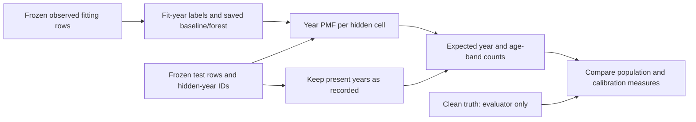

# Overhead-conductor age distributions: point fills versus population estimates

Team 19, Subteam A | 25 October 2026 | Controlled synthetic data only

## Question and method

The frozen Phase 1 pilot found that filling each missing `installation_year` with one median year pushed the estimated test-set share aged 50 or older up by 9.00 percentage points for the conditional baseline. Can the same fitted models yield a better *population* estimate without changing any individual point fill?

For each of the same 600 hidden test years per seed, this extension estimates a probability over installation years 1930-2014. The conditional baseline uses the observed fitting-year histogram from its existing group/backoff rule. The global floor uses the overall observed fitting-year histogram. The frozen Predictive MissForest uses the observed fitting years of records in each query leaf, averaged equally across its final-pass year trees. This is a quantile-regression-forest-style leaf-weight distribution, not the distribution of tree predictions ([Meinshausen, 2006](https://www.jmlr.org/papers/volume7/meinshausen06a/meinshausen06a.pdf)). The evaluator-only generator reference uses the known clean conditional year law; it is not deployed or used under noise.

The completed year distribution is the sum of one-hot observed years and predicted distributions for hidden years, divided by all 2,000 test assets. The aged-50-or-older share sums probability on installation years at most 1964 (2014 snapshot). Each age band and the year-distribution Wasserstein distance are also exported. Individual median/forest point fills and the Phase 1 cell MAE are unchanged.

The pipeline checks that fitting IDs, masks and all originally observed fitting values match the saved forest before extracting leaf distributions. The model is replayed with frozen preprocessing and no refitting. Per-cell test PMFs are saved without truth; calibration outcomes and clean truth remain under evaluator-only outputs. The same split, masks and clean/noisy observed views as the earlier paired noise experiment are used.

## Results

All values below are five-seed *means of signed errors* in percentage points against each test partition's clean truth. They are descriptive for one 10,000-row synthetic population, not SAPN estimates or significance tests.

| Condition | Conditional baseline: point fill | Conditional baseline: expected share | Forest: point fill | Forest: expected share |
| --- | ---: | ---: | ---: | ---: |
| Clean, 30% hidden years | +9.00 | +0.27 | +3.75 | +0.27 |
| 20% observed-year errors, ±2 years | +10.60 | +1.42 | +4.80 | +1.44 |

The clean generator reference changes from +8.16 points using one median year to +0.45 using its full year distribution. The global floor's expected-share error is +0.34. The baseline and forest are close on this population measure despite different individual-year MAE. This is the distinction between a plausible single asset value and a useful population statistic.

**Under MCAR, the population gain comes from using distributions rather than single values; this test cannot show a benefit from conditioning.** The floor, conditional baseline, forest and reference all have small errors of roughly the same order, so they should not be ranked by these five-seed age-share means. Randomly observed years are already representative of the population; the nonzero reference error also shows finite-mask variation.

The distributional result remains sensitive to wrong years that are *present*. Relative to clean, the 20% ±2-year arm increases the baseline's expected-share error by 1.14 points. Of that, +0.80 points come from observed test years crossing the 1964 threshold; +0.35 come from changes in hidden-cell probabilities after noisy fitting and predictors (rounding accounts for the total). The earlier audit found a generated 1966 peak: a -2 error moves those assets to 1964, while fewer assets move the opposite way. No clipping at a year boundary was responsible. In the combined-noise arm, the expected-share errors are +0.88 points for baseline and +0.87 for forest. Excluded-length noise leaves both results exactly at their clean values.

On the reserved clean calibration partition, each method has 1,500 hidden-year cells across five seeds. Brier scores for the binary aged-50-or-older event are 0.2314 (baseline), 0.2309 (forest), 0.2382 (global floor) and 0.2287 (generator reference). Pooled reliability-bin counts and frequencies are exported. The central 0.6-0.8 baseline bin contains 799 cells with mean predicted probability 0.640 and observed frequency 0.641. Extreme bins contain very few cells, so this is an exploratory probability check, **not a claim of calibrated uncertainty or a validated accept/review threshold**.

## Interpretation and limits

- Deliver a point candidate *and* a distributional population view. A low-MAE single year does not preserve the age profile.
- A full year distribution largely removes point-fill distortion under this clean MCAR generator, but it cannot repair plausible wrong observed years.
- Leaf-frequency distributions inherit the fitted forest and this generator's structure; they are not automatically calibrated predictive intervals.
- The five split/mask seeds share one generated population. Results do not establish generalisation to SAPN, structured missingness, different generator laws or downstream PoF stability.
- The 1930-2014 PMF support covers the entire saved clean reference: minimum 1930, maximum 2014, and zero out-of-support years among 10,000 rows. The runner now fails before evaluation if this no longer holds.
- SAPN must confirm field availability, year-error and missingness patterns, and the intended risk/reference calculation before operational conclusions.

The discriminating follow-up is **MAR missingness driven by observed fields**. Its predeclared hypotheses and separate results are in `overhead_v3_mar_design.md` and `overhead_v3_mar_results.md`. The MCAR findings above remain unchanged.

## Reproduce and inspect

See `overhead_v3_age_distribution_runbook.md`. The ignored local output is `outputs/v3_age_distribution_checked_paired_20261025/`. It contains `population_age_metrics.csv`, per-seed and per-condition `predicted_year_pmfs_test.csv.gz`, evaluator-only calibration cells/bins, integrity checks and a manifest with upstream hashes. The prior point prediction outputs are unchanged.
