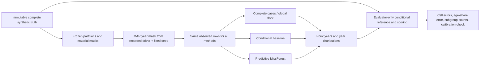

# Overhead-conductor MAR pilot: when conditioning matters

Team 19, Subteam A | 25 October 2026 | PGS219-192 | Synthetic-data experiment

## Question

The earlier MCAR pilot showed that predicted **year distributions**, rather than single filled years, largely removed age-share distortion. The global year histogram performed about as well as conditional methods because the missing years were selected at random. Here the selection depends on recorded asset fields. Does a conditional distribution recover the population age profile when the complete cases no longer represent it?

The four mask mechanisms and exact category probabilities were fixed in `overhead_v3_mar_design.md` before this run. Five split/mask seeds (101-105) reuse the same 10,000-row generated population and frozen 60/10/10/20 partitions. Existing material masks remain unchanged. Only year masks are redrawn from **observed** voltage, location, covering or material; when material is unavailable, the material arm uses its declared neutral 0.30 rate. The simulator has clean truth to restore the original years before masking, but the three fitted methods receive only their incomplete fitting views. Clean-tuning-selected settings are reused; no MAR test result chooses a model setting.

## Main result

Five-seed means below are **signed percentage-point errors** in the completed test-set share aged 50 or older against clean truth. The last two columns are five-seed means of each seed's *absolute* error, which avoid hiding cancellation. These are descriptive values from one synthetic population, not confidence intervals or SAPN performance.

| Year-mask driver | Complete cases | Global floor | Conditional baseline | Predictive MissForest | Generator reference (evaluator only) | Floor mean absolute | Baseline mean absolute |
| --- | ---: | ---: | ---: | ---: | ---: | ---: | ---: |
| Voltage | -1.25 | -1.24 | -0.02 | -0.17 | +0.12 | 1.24 | 0.29 |
| Observed material | +0.98 | +1.02 | -0.09 | -0.05 | +0.15 | 1.02 | 0.38 |
| Location | +0.31 | +0.20 | +0.34 | +0.30 | +0.49 | 0.47 | 0.53 |
| Covering | +0.29 | +0.24 | +0.20 | +0.16 | +0.18 | 0.29 | 0.30 |

Under **voltage-driven MAR**, the floor and complete-case errors are negative in all five seeds. The conditional baseline has lower absolute error than the floor in **5/5** seeds; the forest also does so in **5/5**. Under **observed-material MAR**, the baseline and forest beat the floor in **4/5** seeds. This is the first controlled result here where conditioning on recorded fields materially improves a population estimate. It does not establish a general forest advantage: the simple baseline and forest are close on this measure.

The **location** and **covering** arms do not show a clear gain from conditioning. In this generator, location carries little additional year information after voltage is known; the location arm's selection bias is small compared with five-seed variation. Covered conductors are rare, so selecting them more often has little impact on the overall age share. These outcomes are consistent with the predeclared caveats, not failed experiments to conceal.

## Counts and secondary checks

Across the five 2,000-row test views, realised year-mask rates are 29.95% (voltage), 30.38% (observed material), 28.86% (location) and 30.63% (covering). The named test groups are large enough for the main contrasts: voltage-arm SWER has **270-308** hidden years per seed; location-arm Urban has **90-129**; material-arm Aluminium has **120-140**. But 66 kV has only **13-16** and Covered only **13-21** hidden years per seed. Their subgroup estimates should not be read as precise. `mask_counts.csv` records all group denominators and realised rates.

Cell-level point-year MAE tells a different story from population-share error. In the voltage arm, the conditional baseline averages **9.63 years** MAE on hidden years versus **10.08** for the floor and **10.20** for the forest. In the observed-material arm it averages **10.93** versus **11.83** and **11.51**, respectively. The distributional age-share comparison remains the primary result; a single filled year and a population distribution are different outputs.

The reserved calibration-year masks contain approximately 1,500 cells per arm across five seeds. Binary aged-50-or-older Brier scores are, for voltage: **0.2294** baseline, **0.2292** forest, **0.2372** floor, **0.2273** generator reference; for observed material: **0.2362**, **0.2367**, **0.2450**, **0.2319**. Full calibration cells and bins are evaluator-only. These scores are diagnostic; no probability calibration or review threshold is claimed.

The evaluator-only reference is not zero because each finite masked sample differs from the full test population. Its conditional year law remains valid for these specific MAR mechanisms: the year-mask probability is a function of recorded fields and a random draw, not the hidden year after conditioning on those fields. It would need adjustment for MNAR selection on the unobserved year.

## What this means for SAPN

If missingness is related to fields that are reliably recorded, a global fill or complete-case summary can misstate the age distribution. On this controlled generator, a simple conditional distribution corrects most of the induced bias for the voltage and observed-material mechanisms. That is a reason to **measure real missingness patterns before choosing an imputation method**, not evidence that these synthetic probabilities or model results represent SAPN's register. Noise in present-but-wrong values, MNAR missingness, downstream PoF stability and operational accept/review rules remain separate questions.

## Reproducibility

`overhead_v3_mar_runbook.md` gives the command. The ignored local output `outputs/v3_mar_final_20261025/` includes every observed view and year-mask manifest, saved forest models, per-cell year candidates and distributions, population and hidden-cell metrics, subgroup counts, evaluator-only calibration outcomes, integrity checks and upstream hashes. The MAR output does not modify the prior MCAR or noise artefacts.
