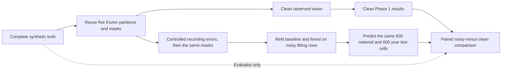

# Overhead conductors: paired clean and noisy evaluation

Team 19, Subteam A | 25 October 2026 | PGS219-192 | Controlled synthetic data only

## Question and design

Does the Phase 1 imputation workflow still recover deliberately hidden material and installation year when some *observed predictors* are recorded incorrectly? Does filling every blank preserve the population quantities that an asset manager might later use?

The population has 10,000 synthetic rows generated with seed 219 and relationship strength 100. For each of five seeds (101-105), 6,000/1,000/1,000/2,000 IDs remain in fitting/tuning/calibration/test. Each test partition has 600 hidden material cells and 600 hidden year cells; some rows have both hidden. The noise arms retain those exact IDs and target masks. The same global floor, conditional baseline and Predictive MissForest are compared. The baseline and forest are **refitted on each noisy fitting view**, using the settings already selected from the clean tuning view. No noisy test answer is used for fitting or tuning. The clean reference joins only after candidate files and integrity checks are saved. There is no generator-reference ceiling for noisy arms.

Eight predeclared arms are: an excluded-length negative control; sea-distance error on 20% of rows (up to 20% relative error); voltage-label replacement at 5%, 10% and 20%; installation-year errors of up to two years at 10% and 20%; and a combined arm with 10% voltage and year errors plus 20% sea-distance errors. The rates are **controlled stress-test settings**, not estimated SAPN error rates. The noise source uses the same rate as both the selected-row fraction and maximum relative numeric error. The noise is applied before the frozen target mask, so an intentionally hidden year remains hidden even if its source record was selected for noise. `material` and `conductor_type` never change; `asset_age` is recomputed when an observed year changes, but is excluded from prediction. `length_km` is also excluded from prediction and is used only from clean truth for evaluator weighting.

## Main results

Numbers below are five-seed means. A positive change in log loss or MAE is worse. The per-seed values and ranges are in `paired_cell_metrics.csv`, with the primary changes in [the compact review table](../results/overhead_conductors/v3_noise/primary_paired_summary.csv); these are descriptive comparisons on one synthetic population, not significance tests.

| Input condition | Baseline material log loss | Change from clean | Forest material log loss | Change from clean |
| --- | ---: | ---: | ---: | ---: |
| Clean | 0.6973 | - | 0.7043 | - |
| Voltage labels, 5% | 0.7033 | +0.0061 | 0.7082 | +0.0039 |
| Voltage labels, 10% | 0.7102 | +0.0129 | 0.7167 | +0.0124 |
| Voltage labels, 20% | 0.7236 | +0.0263 | 0.7224 | +0.0180 |
| Combined arm | 0.7106 | +0.0133 | 0.7161 | +0.0117 |

Voltage error weakens *probability quality* in a roughly dose-dependent way ([paired plot](../images/overhead_conductors/v3_noise/paired_log_loss.png)). The baseline's material point class remains Steel throughout, so its macro-F1 stays at 0.2836. Forest macro-F1 varies slightly by seed and arm, without a consistent gain. The global floor is unchanged by predictor corruption because it does not use the corrupted fields. Every method still fills 100% of the deliberately hidden target cells. **Coverage here means a value was supplied, not that the value is reliable or that a confidence threshold was met.**

At 20% voltage-label noise, the forest has slightly lower **mean** material log loss than the baseline (0.7224 versus 0.7236), reversing their clean-data order. However, it is ahead in only **2 of 5 seeds**; this is a descriptive mean crossover, not a consistent forest advantage. Relative to the clean global floor (0.749853), the clean baseline gained 0.052576 in log loss and then lost 0.026292 under this noise, or **50.0% of its clean gain**. The forest gained 0.045531 and lost 0.018035, or **39.6% of its clean gain**. These percentages are ratios of five-seed mean losses, not means of per-seed percentages; they describe this generator and this corruption arm only.

The clean baseline year MAE is 10.367 years. Under 20% voltage-label replacement it rises to 10.526 years (+0.159); the forest rises from 10.740 to 10.828 years (+0.088). Sea-distance noise has no effect on the conditional baseline because distance is not one of its grouping keys, and it changes forest scores only slightly. The excluded-length negative control changes *no* predictions or metrics across all five seeds; this checks the field boundary rather than proving the model is robust to relevant noise.

Year-recording errors are more visible in population summaries than in hidden-year MAE ([paired plot](../images/overhead_conductors/v3_noise/paired_aged50_population.png)). At 20% of source rows shifted by two years, the baseline hidden-year MAE changes by less than 0.001 year on average, but its completed-test aged-50-or-older share error grows from **+9.00 to +10.60 percentage points**. Even complete-case age-share error grows by 1.19 points. The direction is explained by the synthetic year distribution and the inclusive threshold: in the 2014 snapshot, `installation_year <= 1964` means age 50 or older. Across the five held-out views, among 7,000 observed-year instances, **92** move into that group and **12** move out (net +80). The corresponding complete-case counts are **68** in and **10** out (net +58 of 4,882, or +1.19 percentage points). The generator has a strong 1966 peak: 827 observed-year instances are dated 1966 versus only 53 and 54 dated 1964 and 1965. A -2-year error can move 1966 to 1964, while fewer records are positioned for the reverse threshold crossing. These are seed-view instances, not 7,000 distinct assets. Clipping at the generator's outer year bounds cannot explain crossings at 1964. The methods fill blanks but preserve observed values, including plausible wrong years; the remaining completed-population shift also depends on fitted fills. The combined arm produces a +10.31-point baseline age-share error. This is a data-quality warning, not evidence that missing-year imputation repaired recording errors.

Expected material shares remain much closer to the clean truth than single-label fills in this experiment. In the 20% voltage arm, the baseline's expected Steel-share error changes by about +0.11 percentage points relative to clean, while its point-filled Steel share remains inflated by the Phase 1 majority-class effect. Material and year population findings must therefore be reported separately from individual-cell reconstruction.

## What was checked

- The clean rerun reproduces every pre-existing Phase 1 cell and population metric exactly; only macro-F1, fill coverage and year-standard-deviation error were added.
- All 40 seed-by-arm integrity records passed. The same 2,000 test IDs and 1,200 hidden target cells are used in each paired arm. Forest save/reload and preservation of nonmissing observed cells are checked for each run.
- In the test partition, changed observed voltage cells average about 104, 196 and 383 out of 2,000 for the 5%, 10% and 20% arms. The 20% year arm changes about 274 of the 1,400 *observed* test years. Boundary clipping and masking mean realized counts need not equal the nominal rate times 2,000. The [changed-cell summary](../results/overhead_conductors/v3_noise/observed_change_summary.csv) gives every field and partition denominator.
- The output includes per-class recall, macro-F1, balanced accuracy, material confusion, year MAE and signed bias, fill coverage, year spread, material-by-decade counts and shares, paired population errors, plots and evaluator-only correct/incorrect/uncertain examples. The raw forest vote and tree-range values remain uncalibrated diagnostics.

## Interpretation and limits

This tests one synthetic generator, one relationship-strength setting, MCAR target masking and specific recording-error mechanisms. It does not estimate real SAPN noise rates, demonstrate PoF improvement, or establish general robustness. The voltage dose-response is plausible because voltage is a parent of material and year in this generator. The small sea-distance effect reflects this generator and the selected models, not a claim that coastal exposure is unimportant for asset reliability. For sea-distance noise, the single `noise_level` setting controls both the fraction of selected rows and the maximum relative error, so their separate effects cannot be identified from this experiment. A later design should vary these independently. Location-group, corrosion-zone and *observed material* recording errors were not tested; material is a predictor for year, so these omissions matter. The combined-arm effects need not equal the sum of individual-arm effects because masks, replacements and model refits interact.

Next, review these results with the client and confirm real field availability, likely missingness and recording-error patterns. Calibration, accept/review thresholds, distribution-based year estimates, MAR/MNAR masking and downstream PoF validation remain separate work.

## Verification

The 13 focused v3 pilot/noise tests pass. The repository-wide suite has 155 passes and two failures in `test_predictive_experiment_runner_review.py`; those tests expect CLI flags and a validation error that the committed generic runner does not provide. The mismatch predates this comparison and is documented in the Phase 1 report. It does not involve the v3 pilot or noisy runner. `git diff --check` also passes.

## Reproduction

Run the commands in `overhead_v3_noise_runbook.md`. The verified local clean run is `outputs/v3_phase1_final_20261025/`; the paired noisy run is `outputs/v3_noise_client_20261025/`. Both folders are Git-ignored. Key output hashes are in `overhead_v3_noise_evidence.md`. The SHA-256 hashes of their manifests are:

- Clean: `86677a23cfcd7a10b6b7df111d06f75c4f4488218f25c7683a86bb57722ec3cc`
- Noisy: `63ced4acc4522a770bc81724c812d7c8ccb76fc4343593d3a9c5eb1043c1ee4a`
