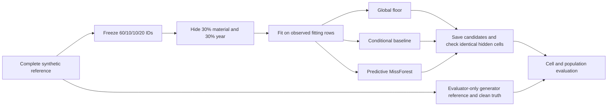

# Overhead-conductor Phase 1 pilot: what the results mean

Team 19, Subteam A | 24 October 2026 | Synthetic-data experiment

## Question

If material and installation year are deliberately removed from a controlled overhead-conductor dataset, do the available asset fields recover more than a global guess? Does a more complex forest improve enough to justify using it **on this generator**? We do not answer that question for SAPN records.

The fixed population has 10,000 rows (generator seed 219, strength 100). Five independent split/mask seeds (101-105) each give 6,000 fitting, 1,000 tuning, 1,000 unused calibration and 2,000 test rows. In each test partition, 600 material values and 600 years are hidden independently. The seven model fields are year, sea distance, voltage, location, corrosion, material and covering. Conductor type, derived age and length are excluded from prediction. The model cannot see the clean answers; the evaluator joins them only after the learned candidates pass integrity checks.

## Results

Values are means across the five seeds. The per-seed values and ranges are in the CSV outputs. These are descriptive comparisons on one synthetic population, not significance tests.

| Method | Material log loss ↓ | Material Brier ↓ | Material point accuracy | Year MAE ↓ |
| --- | ---: | ---: | ---: | ---: |
| Global floor | 0.750 | 0.418 | 74.03% | 10.84 years |
| Conditional baseline | 0.697 | 0.389 | 74.03% | 10.37 years |
| Predictive MissForest, tuning-selected settings | 0.704 | 0.395 | 73.77% | 10.74 years |
| Generator reference, evaluator only | 0.681 | 0.381 | 74.03% | 10.31 years |

The conditional baseline beats the floor on material log loss and year MAE in **all five seeds**. It closes about 76% of the floor-to-reference log-loss gap and 85% of the year-MAE gap **when each seed's gap-closed ratio is calculated first and the five ratios are averaged**. Taking the ratio of the three five-seed mean MAEs instead gives 89%; these are different summaries of the same runs. Predictive MissForest uses 24 trees and per-seed tuning-selected depth, leaf size and pass count. It still does not beat the conditional baseline on either measure in any of the five seeds. This compares these implementations on this generator; it does not establish that forests are generally worse. The validation curves show that deeper trees can worsen tuning loss; the learning curve shows both forest measures improving as more fitting records are available.

**Leakage and scoring checks.** The baseline groups material by voltage, an era bin learned from the *observed fitting years* using two quantile cut points, and corrosion. It does not use the generator's 1950/1980 material boundaries. The generator boundaries appear only in the evaluator-only audit and reference calculation. Material log loss clips the probability assigned to the true class to at least `1e-12` before taking its logarithm. No true material in the five frozen test partitions received zero probability from the forest, so this clip did not alter the reported forest scores. Forest class probabilities are averages of leaf class proportions, not necessarily multiples of 1/24.

**Tree-count sensitivity, tuning rows only.** Holding each seed's selected depth, leaf size and passes fixed, 24 versus 200 trees gave mean tuning material log loss of 0.6954 versus 0.6962 and mean year MAE of 10.91 versus 10.95. Neither setting produced a zero true-class probability on the tuning rows. More trees did not rescue the forest on this check. This does not revise or reuse the frozen test results; the per-seed evidence is in `outputs/v3_tree_count_tuning_age50_20261024.csv`.

**Why material accuracy barely moves.** In the generator's configured material law, Steel is the most likely class for all 45 voltage x material-era x corrosion combinations. The best single guess is therefore Steel for every row, even when the conditional probabilities differ. All 45 group probabilities were checked analytically. In the finite generated sample, five groups have a non-Steel plurality or a tie; these are sampling outcomes, not a contradiction of the configured law. The conditional baseline's gain is in probability quality, not in guessing more individual minority materials correctly. Copper and Aluminium recall remains zero for the floor and conditional baseline. The forest finds a few minority cases but has slightly worse overall point accuracy.

**Point fills can distort the population.** Filling uncertain material with the single most likely class inflates the completed test-set Steel share by 7.79 percentage points for the floor, conditional baseline and generator reference. Instead, adding predicted *probabilities* to the observed class counts puts the estimated Steel share within about 0.44, 0.38 and 0.33 percentage points of truth, respectively (mean signed error; the tuned forest is about 0.19 points low). Length-weighted expected shares are also reported, with length used only by the evaluator. A good probability estimate and a good one-label fill are different products.

**Year error has a different failure mode.** The conditional baseline's MAE is near the generator reference, but its point medians increase the estimated share **aged 50 or older** by 9.0 percentage points. The floor increases it by 12.56 points; the tuned forest by 3.75 points. Even the generator-reference median increases it by 8.16 points. Length-weighted errors are similar: 9.0 points for the conditional baseline and 2.9 points for the forest. The measure includes assets aged exactly 50 at the 2014 snapshot; it is not a strict greater-than-50 threshold. The year objective (minimum absolute error for individual cells) does not automatically preserve the age distribution. For true assets aged 65+, the conditional baseline predicts installation years about 14 years too late on average, making those assets appear younger. The forest's near-zero **overall** year bias hides about 17.6 years of late-year bias in that old group. Age-band diagnostics are essential.

**A raw tree range is not an uncertainty interval.** The forest's per-tree 10th-to-90th percentile range contains the true year in only **13.1%** of hidden test cells, with a mean width of 6.2 years. The baseline's group-year q10-q90 range covers **80.6%**, with a mean width of 32.0 years. These are empirical checks, not calibrated predictive intervals. In particular, the forest range is much too narrow to tell a client that there is an 80% chance the true year falls inside it.

Under this MCAR test, simply retaining complete cases gives population shares and the aged-50-or-older share close to the full test reference. That is expected when omissions are random; it is not evidence that complete-case analysis would work under structured missingness in a real register.

## What this pilot establishes

The end-to-end data boundary, identical masks, train-only fitting, per-seed forest tuning, frozen forest replay, common candidate format, evaluator-only reference and paired metrics are implemented and reproducible. Each of the five runs passed key, domain, probability, observed-cell-preservation and reload checks. Separate tables report subgroup errors and material confusion by era, voltage and location; baseline backoff reasons; complete-case comparisons; and length-weighted population measures. The generator reference is analytically derived for this particular clean MCAR setup; it is not a benchmark that can be carried unchanged into MNAR or a new generator. Forest class proportions and tree-year quantiles are uncalibrated diagnostics. No accept/review threshold, noise correction, PoF result or SAPN-data performance is claimed.

The next experiment should use the reserved calibration partition to examine material probability calibration and an accept-or-review rule, without changing these test results. Then evaluate missingness and predictor-noise scenarios separately. For a client-facing data strategy, confirm which seven fields exist in SAPN's register, the actual missingness rates, and whether conductor type permits a direct material lookup before proposing imputation for that field.

The repository-wide test suite has two failures in `test_predictive_experiment_runner_review.py`: those tests call CLI options and expect a validation error that the committed runner no longer provides. The mismatch is present in `HEAD` and occurs before this v3 pilot code runs. The focused v3 tests pass. These runner failures remain a separate maintenance task, not evidence that this pilot's saved results failed integrity checks.

## Reproduction

Run the command in `overhead_v3_phase1_runbook.md`. The verified output is in `outputs/v3_phase1_age50_label_20261024/` (Git-ignored): `cell_metrics.csv`, `population_metrics.csv`, tuning/learning curves, subgroup diagnostics, per-seed candidates, paired differences, gap-closed measures, material-generator checks and evaluator-only review cases. `manifest.json` records source, configuration and truth hashes for exact provenance. The only difference from the earlier checked run is the inclusive age-threshold metric name; its cell and population values are unchanged.
