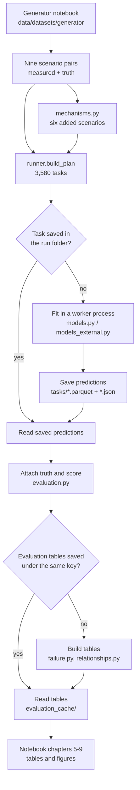

# Design document

**Imputation of missing values in a synthetic asset dataset**

Team 19 · University of Adelaide · SA Power Networks · Final version, November 2026

This document describes how the study is built: its scope, workflow, code structure, data model, the libraries it
uses, the design decisions and their reasons, and the tests that check it. The notebook
`notebooks/imputation.ipynb` runs the experiments and explains how to read each result; `README.md` explains how to
install and run the project.

## Contents

1. [Purpose and scope](#1-purpose-and-scope)
2. [Workflow](#2-workflow)
3. [Repository structure](#3-repository-structure)
4. [Code structure](#4-code-structure)
5. [Data model and saved results](#5-data-model-and-saved-results)
6. [Models](#6-models)
7. [Evaluation design](#7-evaluation-design)
8. [Design decisions](#8-design-decisions)
9. [Libraries](#9-libraries)
10. [Testing](#10-testing)
11. [Reproducibility and runtime](#11-reproducibility-and-runtime)
12. [Limitations](#12-limitations)
13. [References](#13-references)

## 1. Purpose and scope

Asset registers are rarely complete. The study measures how well a missing attribute of an asset record can be
recovered from the other attributes of the same record, and identifies the conditions under which recovery degrades,
the form the degradation takes, and its causes.

| In scope | Out of scope |
|---|---|
| A synthetic register of 10,000 assets and 15 attributes with known truth | Real SA Power Networks data |
| Eleven imputation models and a median/mode baseline under one protocol | Methods that return ranges or multiple imputations for scoring |
| Fifteen scenarios of missingness, noise and recording errors | Missingness mechanisms beyond those in section 7.2 |
| Main comparison: Random Forest and GMM against the baseline | Deployment, user interface or data pipelines |

**Requirements the design meets.**

| Requirement | How it is met |
|---|---|
| Every score is honest | Out-of-fold prediction; truth read only after fitting; automated leakage counts (notebook section 8.6) |
| Models discover relationships themselves | Models receive measured data only; the generator's formulas are used only to organise the evaluation |
| Results are reproducible | Fixed seeds, exact package versions, and a run contract that ties saved predictions to code, data and settings |
| The notebook runs quickly | Predictions and evaluation tables are saved in the run folder and reused; a full run of the notebook takes about 30 seconds |
| Every comparison is interpretable | Skill relative to the baseline on the same cells; the baseline appears in every comparison |

## 2. Workflow



1. **Data.** The generator notebook writes nine pairs of files (`completion` 0.7/0.8/0.9 × `noise` 0/0.05/0.1). Each
   pair holds a `truth` table and a `measured` table with noise and hidden cells.
2. **Added scenarios.** `mechanisms.py` derives six scenarios from the generator's files: gaps by asset age, gaps by
   value, gaps in blocks of related columns, wrong recorded values, and 0.5 and 0.3 completion.
3. **Plan.** `runner.build_plan` lists every task. A task is one model fitted on one fold of one scenario in one
   experiment.
4. **Fitting.** `runner.run_plan` runs the unfinished tasks in parallel worker processes. Each task reads only the
   measured file, fits on four folds and predicts the hidden cells of the fifth. Its predictions are written to a
   Parquet file, and a JSON marker written last commits the task.
5. **Scoring.** `study.Study` reads each model's predictions, attaches the truth and computes scores against the
   baseline on the same cells.
6. **Evaluation.** `study.Study.finish` builds every table of the evaluation chapters from cell-level results and saves
   them in the run folder.
7. **Notebook.** Chapters 5 to 9 display the tables and draw the figures; every figure is also saved as a PNG file in
   the run folder.

## 3. Repository structure

| Path | Content |
|---|---|
| `notebooks/imputation.ipynb` | The study notebook, saved with the outputs of the final run |
| `src/synthetic_imputation/` | The study package |
| `tests/` | Automated tests (section 10) |
| `data/datasets/` | The nine generator scenarios and the generator notebook (`generator/SyntheticDataset.ipynb`) |
| `data/datasets_mechanisms/` | The six added scenarios, rewritten from the generator's files on every run |
| `outputs/imputation-study/runs/20261115-121714/` | The final run: task predictions, run contract, evaluation tables, figures and completed tables |
| `outputs/imputation-study/optimisation/` | Records of the settings selection: rules, candidates, scores and scripts |
| `outputs/imputation-study/tools/` | Scripts that build and run the notebook and fit models outside it |
| `docs/DESIGN.md` | This document |
| `requirements.txt`, `pyproject.toml` | Exact package versions and the package definition |

## 4. Code structure

The package has two layers. The **prediction layer** produces predictions and never reads truth. The **evaluation
layer** turns saved predictions into scores, tables and figures. Only the prediction layer is part of the run
contract, so the evaluation can change without refitting any model.

| Module | Layer | Responsibility |
|---|---|---|
| `columns.py` | Prediction | Meaning, type, valid range, noise and tolerance of each column; the generator's definition as a graph |
| `data.py` | Prediction | Reading and auditing the measured and truth files; file hashes |
| `models.py` | Prediction | The baseline and the models implemented in the study, including the chained imputer with a ridge base |
| `models_external.py` | Prediction | Adapters that give the models in `vendor/` the same folds, inputs and outputs as the other models |
| `vendor/` | Prediction | Model code from the project's shared source code, used unchanged |
| `miceforest_compat.py` | Prediction | Audited fixes for miceforest 6.0.5 |
| `runner.py` | Prediction | Settings, task plan, fold assignment, parallel execution, saving and the run contract |
| `mechanisms.py` | Data | Builds the six added scenarios from the generator's files |
| `study.py` | Evaluation | Runs each model section, reuses saved tasks and saved tables, builds the evaluation tables |
| `evaluation.py` | Evaluation | Scores, paired bootstrap intervals, scenario effects, stability, cost and exported completed tables |
| `failure.py` | Evaluation | Tables on the conditions, characteristics and causes of failure; model groups and main models |
| `relationships.py` | Evaluation | Checks of the estimates against the generator's definitions |
| `names.py` | Evaluation | Model names shown in tables and figures |
| `figures.py` | Evaluation | Chart style and every chart type |

**Coding conventions.** Every module starts with a docstring stating its purpose, and every public function and class
of the evaluation layer has a docstring. Comments explain why a step is taken, not what the code does. Names are full
words. Constants are upper case and defined at the top of their module. Each model is one class with `fit` and
`predict` (or `transform`) methods, following the scikit-learn interface. Modules of the prediction layer are not edited
once a run has been saved, because any change, including to a comment, invalidates the run contract.

**Notebook conventions.** Tables and figures are numbered by section (Table 6.3a, Figure 6.3a) through
`figures.table` and `figures.caption`: a table's caption stands above it and a figure's caption below it, and the
text cites them by number. Where a table or figure is repeated for each main model, a marks Random Forest and b marks GMM. Formulas are written
in LaTeX, and code, column and file names in backticks. Every code cell starts with a comment that states what it
shows. The notebook is written by `outputs/imputation-study/tools/build_notebook.py`, so text and code are
changed there and the notebook is rebuilt.

## 5. Data model and saved results

**Task.** `runner.Task` is a frozen data class: scenario, experiment, variant, fold seed, fold, target and method. Its
`task_id` is the first 20 characters of a SHA-256 hash of these fields, so a task has the same identity in every run.

**Run folder** (`outputs/imputation-study/runs/<start time>/`).

| Item | Content |
|---|---|
| `contract.json` | Settings, SHA-256 hashes of every data file and of every prediction-layer source file |
| `tasks/<task_id>.parquet` | One row per predicted cell: row, target, raw and limited prediction, and `model_id` class probabilities |
| `tasks/<task_id>.json` | Task metadata, status, timings and warnings; written last, so its presence commits the task |
| `task_log_<model>.csv` | The metadata of every task of one model section |
| `evaluation_cache/*.pkl` | Saved evaluation tables, each stored with the key it was built under |
| `*.csv` | Every evaluation table, for use outside Python |
| `figures/*.png` | Every figure of the notebook |
| `completed/` | One completed representative table per model, without truth columns |

**Reuse rules.**

| Saved item | Reused while | Rebuilt when |
|---|---|---|
| Task predictions | The run contract matches: same settings, data files and prediction code | A task has no JSON marker |
| Evaluation tables | The key matches: same run contract, evaluation code (`EVALUATION_SOURCES`) and set of finished tasks | Any of these changes |

## 6. Models

| Model | Group | Method | Source |
|---|---|---|---|
| Median and mode | Baseline | One value per column from the training fold | `models.py` |
| KNN imputer | Chained, selected settings | Ridge base, then a distance-weighted average of the nearest rows | `models.py` |
| IterativeImputer | Chained, selected settings | Chained equations with a ridge on linear and second-order terms | `models.py` |
| **Random Forest** | Chained, selected settings | Ridge base, then a random forest on what the ridge leaves (MissForest style) | `models.py` |
| HistGradientBoosting | Chained, selected settings | Ridge base, then histogram gradient boosting | `models.py` |
| CatBoost | Chained, selected settings | Ridge base, then boosting on symmetric trees | `models.py` |
| miceforest direct | Chained, selected settings | Chained LightGBM without donor matching or ridge base | `models.py` |
| **GMM** | Joint models | Gaussian mixture fitted by EM on incomplete rows | `vendor/`, via `models_external.py` |
| Masked MLP | Joint models | Neural network trained to rebuild cells hidden on purpose (ReMasker style) | `vendor/`, via `models_external.py` |
| LightGBM chained | Chained, documented settings | Median start, then chained LightGBM | `vendor/`, via `models_external.py` |
| Predictive MissForest | Chained, documented settings | Mean start, then chained random forests that are stored and replayed | `vendor/`, via `models_external.py` |
| MICE-PMM | Chained, documented settings | Chained equations with predictive mean matching | `vendor/`, via `models_external.py` |

Settings are defined in `runner.default_parameters`; notebook chapter 4 lists them with each model. Random Forest and
GMM are the main models: one tree-based chained model and one joint probabilistic model.

## 7. Evaluation design

### 7.1 Protocol

- **Folds.** Five folds with seed 219, shared by all models. Each hidden cell is predicted by a model fitted without its
  row. Seeds 220 and 221 repeat the representative scenario to measure sensitivity to the split.
- **Skill.** 1 − (model MAE ÷ baseline MAE) on the same cells. 0 equals the baseline and 1 is perfect.
- **Failure criterion.** Skill of 0.5 or more works, 0.1 to 0.5 is weak, below 0.1 fails.
- **Negative control.** `random_placebo` is unrelated to every other column; no model should beat the median on it.
- **Uncertainty.** Paired row-bootstrap intervals (1,000 draws) on the same cells.

### 7.2 Experiments

| Experiment | Purpose | Tasks |
|---|---|---:|
| `main` | Every model in the nine generator scenarios | 1,170 |
| `mechanism` | Every model in the six added scenarios | 780 |
| `ablation` | Models refitted without one block of predictor columns | 750 |
| `importance` | Permutation importance from single-target Random Forest and CatBoost models | 450 |
| `stability` | Representative scenario with fold seeds 220 and 221 | 260 |
| `spatial` | Representative scenario with folds of whole 10 × 10 grid blocks | 130 |
| `structure` | The four chained models with a ridge base, refitted without it | 20 |
| `budget` | IterativeImputer with 5 and 30 passes | 10 |
| `calibration` | Random Forest with calibrated `model_id` probabilities | 10 |
| **Total** | | **3,580** |

### 7.3 Notebook structure

| Chapter | Content |
|---|---|
| 1–3 | Setup, data and experimental design |
| 4 | One section per model: method, settings, results in the representative scenario |
| 5 | Overview of all models: failure criterion, overall performance, condition maps |
| 6 | Conditions of degradation, from whole-table conditions to single cells |
| 7 | Characteristics of failure: shrinkage, range, shape of decline, relationships, confidence |
| 8 | Causes of failure: data limits, reliance on linked columns, noise, predictor removal, structure, validity checks |
| 9 | Value of imputation for downstream summary statistics |
| 10 | Limitations |
| Appendix | Pairwise comparisons, fold-seed stability, runtime and warnings, exported tables, references |

## 8. Design decisions

| # | Decision | Alternatives considered | Reason |
|---|---|---|---|
| D1 | Synthetic data with known truth | Real register data | Every imputed value can be scored, and noise, missingness and relationships can be controlled one at a time |
| D2 | Out-of-fold prediction with shared folds | In-sample completion of the whole table | A model never sees the row it fills, and all models are compared on identical cells |
| D3 | Skill relative to the baseline as the main measure | Raw MAE; tolerance rates | Skill has no unit, so columns and conditions can be compared; tolerance rates depend on each column's range |
| D4 | Models receive no relationship information | Engineered features from the generator's formulas | The study tests whether models discover relationships; features from the formulas would answer the question in advance |
| D5 | Settings chosen by a fixed rule on cells visible in every scenario, without truth | Tuning per scenario or against truth | Settings cannot adapt to the evaluation, and differences between scenarios are not caused by settings |
| D6 | Chained imputation with a ridge base on second-order terms | Local model alone | Trees and neighbours approximate sums with many small steps; the ridge takes the smooth part. It scored best in selection, and section 8.5 measures its effect against truth |
| D7 | Estimates limited to each column's training range | No limit | Without it the ridge base diverged at 0.3 completion; the earlier run is kept as the record |
| D8 | External models run unchanged through an adapter, with generator-encoding features off | Reimplementing them; keeping all features | Their code stays as written, while every model is held to the same protocol and the same information |
| D9 | Random Forest and GMM as the main models | Comparing all models in every chapter | One tree-based chained model and one joint probabilistic model keep chapters 6 to 9 readable; chapter 5 still compares all models |
| D10 | Run contract with hashes of data, settings and prediction code | Re-running after every change | Saved predictions are reused only when they are guaranteed to be valid; fitting takes about 2 hours 20 minutes |
| D11 | Two layers with only the prediction layer in the contract | One package hash | Evaluation code and figures can be improved without refitting |
| D12 | Saved evaluation tables keyed by contract, evaluation code and finished tasks | Rebuilding on every run | The notebook runs in about 30 seconds and can never show tables from other code or other tasks |
| D13 | A task committed by a JSON marker written last | Writing results in one step | An interrupted run loses only the tasks in progress and never leaves a partial result that looks finished |
| D14 | Spatial block folds as an additional experiment | Spatial folds for every experiment | Random folds are the main protocol; block folds measure the effect of predicting in areas without training records |
| D15 | Exact package versions; miceforest 6.0.5 with an audited patch | Latest versions | Later LightGBM versions break miceforest, and exact versions make the run reproducible |

## 9. Libraries

Versions are pinned in `requirements.txt` (Python 3.12).

| Library | Version | Use |
|---|---|---|
| NumPy | 2.5.4 | Arrays and numerical routines |
| pandas | 2.3.3 | Tables, scoring and aggregation |
| SciPy | 1.18.1 | Linear algebra, nearest-neighbour search and tests inside MICE-PMM |
| scikit-learn | 1.9.1 | KNN, IterativeImputer, Random Forest, HistGradientBoosting, ridge, calibration, cross-validated fits |
| CatBoost | 1.2.10 | CatBoost models |
| LightGBM | 4.5.0 | Boosting inside miceforest and the LightGBM chain |
| miceforest | 6.0.5 | Chained LightGBM imputation (miceforest direct) |
| PyTorch | 2.9.1 | The masked MLP |
| Matplotlib | 3.11.2 | Figures |
| PyArrow | 26.0.1 | Parquet files of task predictions |
| joblib | 1.6.0 | Parallel worker processes |
| psutil | 7.2.2 | Number of physical cores for the worker count |
| threadpoolctl | 3.7.0 | One thread per worker, so results do not depend on the machine |
| ipykernel, notebook, nbconvert | 7.4.0, 7.6.4, 7.17.2 | Running the notebook |
| pytest | 8.4.2 | Tests |

## 10. Testing

The tests use small generated frames and need no dataset files, except the notebook checks, which read the saved
notebook. Run them from the project folder:

```
pytest
```

| Area | What is checked |
|---|---|
| Column definitions | Every column is a target and described once; noise and tolerance follow the definitions |
| Scoring | Failed predictions count as misses; skill is measured against the baseline on the same cells |
| Models | Every model fills every column, handles missing predictors and learns a simple signal |
| Chained imputation | Estimates stay in range, do not depend on other test rows, and recover known relations |
| Protocol | Folds partition the rows; the plan has unique tasks; spatial folds keep blocks together; MICE-PMM draws donors from training rows only |
| Scenarios | Added scenarios hide the same share in a different pattern; the errors scenario changes only visible values |
| Run contract | Only prediction code decides whether a run can be reused |
| Evaluation layer | Shown names, main models and groups; saved tables reused only under the same key |
| Notebook | Every code cell has run without errors; cell ids are unique; wording and headings follow the conventions; every table and figure has a unique numbered caption and every one the text cites is shown |

Every test case:

| # | Test | File | Cases | Checks that |
|---:|---|---|---:|---|
| 1 | `test_shown_names_rename_only_the_mixture_model` | `test_evaluation_layer.py` | 1 | Shown names rename only the mixture model |
| 2 | `test_shown_names_stay_unique_across_model_sections` | `test_evaluation_layer.py` | 1 | Shown names stay unique across model sections |
| 3 | `test_main_models_are_one_tree_based_and_one_joint_model` | `test_evaluation_layer.py` | 1 | Main models are one tree based and one joint model |
| 4 | `test_every_model_belongs_to_exactly_one_group` | `test_evaluation_layer.py` | 1 | Every model belongs to exactly one group |
| 5 | `test_evaluation_code_is_outside_the_run_contract` | `test_evaluation_layer.py` | 1 | Evaluation code is outside the run contract |
| 6 | `test_saved_tables_are_reused_only_under_the_same_key` | `test_evaluation_layer.py` | 1 | Saved tables are reused only under the same key |
| 7 | `test_table_key_follows_the_finished_tasks_and_not_their_order` | `test_evaluation_layer.py` | 1 | Table key follows the finished tasks and not their order |
| 8 | `test_table_key_changes_with_the_run_contract` | `test_evaluation_layer.py` | 1 | Table key changes with the run contract |
| 9 | `test_stacked_tables_keep_the_model_and_the_row_labels` | `test_evaluation_layer.py` | 1 | Stacked tables keep the model and the row labels |
| 10 | `test_notebook_runs_without_errors_and_every_code_cell_has_run` | `test_evaluation_layer.py` | 1 | Notebook runs without errors and every code cell has run |
| 11 | `test_notebook_cells_have_unique_ids` | `test_evaluation_layer.py` | 1 | Notebook cells have unique ids |
| 12 | `test_notebook_text_uses_the_shared_model_names_and_neutral_wording` | `test_evaluation_layer.py` | 1 | Notebook text uses the shared model names and neutral wording |
| 13 | `test_notebook_headings_name_their_content_without_question_words` | `test_evaluation_layer.py` | 1 | Notebook headings name their content without question words |
| 14 | `test_tables_and_figures_carry_unique_numbered_captions` | `test_evaluation_layer.py` | 1 | Tables and figures carry unique numbered captions |
| 15 | `test_every_table_and_figure_cited_in_the_text_is_shown` | `test_evaluation_layer.py` | 1 | Every table and figure cited in the text is shown |
| 16 | `test_every_column_is_a_target_and_is_described_once` | `test_imputation_study.py` | 1 | Every column is a target and is described once |
| 17 | `test_only_measured_readings_are_noisy` | `test_imputation_study.py` | 1 | Only measured readings are noisy |
| 18 | `test_finalise_applies_the_column_definition` | `test_imputation_study.py` | 1 | Finalise applies the column definition |
| 19 | `test_interval_columns_use_absolute_tolerance` | `test_imputation_study.py` | 1 | Interval columns use absolute tolerance |
| 20 | `test_tolerance_excludes_true_zero_from_relative_denominator` | `test_imputation_study.py` | 1 | Tolerance excludes true zero from relative denominator |
| 21 | `test_failed_predictions_count_as_misses` | `test_imputation_study.py` | 1 | Failed predictions count as misses |
| 22 | `test_class_scores_report_accuracy` | `test_imputation_study.py` | 1 | Class scores report accuracy |
| 23 | `test_features_keep_gaps_and_treat_category_as_nominal` | `test_imputation_study.py` | 1 | Features keep gaps and treat category as nominal |
| 24 | `test_single_target_models_handle_missing_predictors_and_learn_a_simple_signal` | `test_imputation_study.py` | 2 | Single target models handle missing predictors and learn a simple signal |
| 25 | `test_baseline_returns_the_observed_median` | `test_imputation_study.py` | 1 | Baseline returns the observed median |
| 26 | `test_classifiers_return_class_probabilities_with_missing_predictors` | `test_imputation_study.py` | 1 | Classifiers return class probabilities with missing predictors |
| 27 | `test_miceforest_runs_as_gradient_boosting` | `test_imputation_study.py` | 1 | Miceforest runs as gradient boosting |
| 28 | `test_every_planned_method_belongs_to_one_notebook_section` | `test_imputation_study.py` | 1 | Every planned method belongs to one notebook section |
| 29 | `test_folds_are_a_partition_and_repeatable` | `test_imputation_study.py` | 1 | Folds are a partition and repeatable |
| 30 | `test_chained_imputer_recovers_a_linear_relation_in_original_units` | `test_imputation_study.py` | 1 | Chained imputer recovers a linear relation in original units |
| 31 | `test_block_ridge_fits_a_product_that_a_line_cannot` | `test_imputation_study.py` | 1 | Block ridge fits a product that a line cannot |
| 32 | `test_block_ridge_applies_a_separate_penalty_to_each_block` | `test_imputation_study.py` | 1 | Block ridge applies a separate penalty to each block |
| 33 | `test_chained_models_fill_every_numeric_column_and_give_class_probabilities` | `test_imputation_study.py` | 5 | Chained models fill every numeric column and give class probabilities |
| 34 | `test_chained_estimate_of_a_row_does_not_depend_on_other_test_rows` | `test_imputation_study.py` | 5 | Chained estimate of a row does not depend on other test rows |
| 35 | `test_chains_in_ablation_drop_the_block_and_keep_model_id` | `test_imputation_study.py` | 1 | Chains in ablation drop the block and keep model_id |
| 36 | `test_cost_shares_a_chained_task_between_the_columns_it_covers` | `test_imputation_study.py` | 1 | Cost shares a chained task between the columns it covers |
| 37 | `test_neighbours_fall_back_for_a_row_with_no_shared_cells` | `test_imputation_study.py` | 1 | Neighbours fall back for a row with no shared cells |
| 38 | `test_neighbours_give_the_same_estimates_in_blocks_as_in_one_call` | `test_imputation_study.py` | 1 | Neighbours give the same estimates in blocks as in one call |
| 39 | `test_chained_methods_are_one_task_per_fold` | `test_imputation_study.py` | 1 | Chained methods are one task per fold |
| 40 | `test_chained_estimates_stay_inside_the_observed_range` | `test_imputation_study.py` | 1 | Chained estimates stay inside the observed range |
| 41 | `test_plan_has_unique_tasks_and_skips_targets_inside_a_removed_block` | `test_imputation_study.py` | 1 | Plan has unique tasks and skips targets inside a removed block |
| 42 | `test_iterative_imputer_is_one_task_per_fold` | `test_imputation_study.py` | 1 | Iterative imputer is one task per fold |
| 43 | `test_relationship_residuals_detect_a_broken_definition` | `test_imputation_study.py` | 1 | Relationship residuals detect a broken definition |
| 44 | `test_file_pattern_reads_both_controls` | `test_imputation_study.py` | 1 | File pattern reads both controls |
| 45 | `test_only_prediction_code_decides_whether_a_run_can_be_reused` | `test_imputation_study.py` | 1 | Only prediction code decides whether a run can be reused |
| 46 | `test_calibration_uses_the_forest_of_the_raw_result` | `test_imputation_study.py` | 1 | Calibration uses the forest of the raw result |
| 47 | `test_life_definition_matches_each_model` | `test_imputation_study.py` | 1 | Life definition matches each model |
| 48 | `test_leakage_range_contains_the_true_value` | `test_imputation_study.py` | 1 | Leakage range contains the true value |
| 49 | `test_relation_table_uses_only_cells_with_every_input_visible` | `test_imputation_study.py` | 1 | Relation table uses only cells with every input visible |
| 50 | `test_mechanism_files_hide_the_same_share_in_a_different_pattern` | `test_imputation_study.py` | 1 | Mechanism files hide the same share in a different pattern |
| 51 | `test_a_chain_without_the_ridge_base_uses_only_the_local_model` | `test_imputation_study.py` | 1 | A chain without the ridge base uses only the local model |
| 52 | `test_plan_covers_mechanisms_structure_and_every_importance_fold` | `test_imputation_study.py` | 1 | Plan covers mechanisms structure and every importance fold |
| 53 | `test_cells_carry_the_baseline_error_and_the_visible_links` | `test_imputation_study.py` | 1 | Cells carry the baseline error and the visible links |
| 54 | `test_skill_is_measured_against_the_baseline_on_the_same_cells` | `test_imputation_study.py` | 1 | Skill is measured against the baseline on the same cells |
| 55 | `test_failure_standard_has_three_states` | `test_imputation_study.py` | 1 | Failure standard has three states |
| 56 | `test_links_follow_the_generator_definition` | `test_imputation_study.py` | 1 | Links follow the generator definition |
| 57 | `test_downstream_values_of_the_truth_have_no_error` | `test_imputation_study.py` | 1 | Downstream values of the truth have no error |
| 58 | `test_scenario_effects_do_not_depend_on_the_order_of_rows` | `test_imputation_study.py` | 1 | Scenario effects do not depend on the order of rows |
| 59 | `test_external_models_fill_every_numeric_column_and_give_class_probabilities` | `test_imputation_study.py` | 5 | External models fill every numeric column and give class probabilities |
| 60 | `test_external_models_accept_a_removed_predictor_block` | `test_imputation_study.py` | 1 | External models accept a removed predictor block |
| 61 | `test_tile_folds_keep_whole_blocks_together` | `test_imputation_study.py` | 1 | Tile folds keep whole blocks together |
| 62 | `test_errors_scenario_changes_only_visible_dates_and_models` | `test_imputation_study.py` | 1 | Errors scenario changes only visible dates and models |
| 63 | `test_mice_pmm_draws_test_gaps_only_from_training_rows` | `test_imputation_study.py` | 1 | Mice pmm draws test gaps only from training rows |
| 64 | `test_chain_estimates_stay_inside_the_training_range` | `test_imputation_study.py` | 1 | Chain estimates stay inside the training range |

77 test cases in 64 tests; all pass.

## 11. Reproducibility and runtime

| Action | Time on the machine used (12 worker processes) |
|---|---|
| Fit every model from scratch (`RUN_ID = None`) | About 2 hours 20 minutes |
| Rebuild the evaluation tables after a change to the evaluation code | About 3 minutes |
| Run the notebook with saved predictions and tables | About 30 seconds |
| Run the tests | About 10 seconds |

The run contract and fixed seeds (219 for the generator and folds, 220 and 221 for stability) make every saved number
reproducible. Parallel workers are single-threaded, so results do not depend on the number of cores.

## 12. Limitations

The data is synthetic and has one generated truth table. Numeric estimates are single values. Four chained models share
the ridge base. External models run with their generator-encoding features off, so their results differ from those
reported with their source code. Notebook chapter 10 lists every limitation.

## 13. References

- Breiman, L. (2001). Random forests. *Machine Learning*, 45(1), 5–32.
- Dempster, A. P., Laird, N. M., & Rubin, D. B. (1977). Maximum likelihood from incomplete data via the EM algorithm. *Journal of the Royal Statistical Society: Series B*, 39(1), 1–38.
- Du, T., Melis, L., & Wang, T. (2024). ReMasker: Imputing tabular data with masked autoencoding. *International Conference on Learning Representations (ICLR)*.
- Efron, B., & Tibshirani, R. J. (1993). *An Introduction to the Bootstrap*. Chapman & Hall.
- Friedman, J. H. (2001). Greedy function approximation: A gradient boosting machine. *The Annals of Statistics*, 29(5), 1189–1232.
- Ghahramani, Z., & Jordan, M. I. (1994). Supervised learning from incomplete data via an EM approach. *Advances in Neural Information Processing Systems*, 6, 120–127.
- Hoerl, A. E., & Kennard, R. W. (1970). Ridge regression: Biased estimation for nonorthogonal problems. *Technometrics*, 12(1), 55–67.
- Ke, G., Meng, Q., Finley, T., Wang, T., Chen, W., Ma, W., Ye, Q., & Liu, T.-Y. (2017). LightGBM: A highly efficient gradient boosting decision tree. *Advances in Neural Information Processing Systems*, 30.
- Little, R. J. A. (1988). Missing-data adjustments in large surveys. *Journal of Business & Economic Statistics*, 6(3), 287–296.
- Little, R. J. A., & Rubin, D. B. (2019). *Statistical Analysis with Missing Data* (3rd ed.). Wiley.
- Pedregosa, F., et al. (2011). Scikit-learn: Machine learning in Python. *Journal of Machine Learning Research*, 12, 2825–2830.
- Prokhorenkova, L., Gusev, G., Vorobev, A., Dorogush, A. V., & Gulin, A. (2018). CatBoost: Unbiased boosting with categorical features. *Advances in Neural Information Processing Systems*, 31.
- Roberts, D. R., et al. (2017). Cross-validation strategies for data with temporal, spatial, hierarchical, or phylogenetic structure. *Ecography*, 40(8), 913–929.
- Rubin, D. B. (1976). Inference and missing data. *Biometrika*, 63(3), 581–592.
- Stekhoven, D. J., & Bühlmann, P. (2012). MissForest: Non-parametric missing value imputation for mixed-type data. *Bioinformatics*, 28(1), 112–118.
- Troyanskaya, O., Cantor, M., Sherlock, G., Brown, P., Hastie, T., Tibshirani, R., Botstein, D., & Altman, R. B. (2001). Missing value estimation methods for DNA microarrays. *Bioinformatics*, 17(6), 520–525.
- van Buuren, S., & Groothuis-Oudshoorn, K. (2011). mice: Multivariate imputation by chained equations in R. *Journal of Statistical Software*, 45(3), 1–67.
